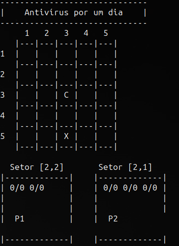
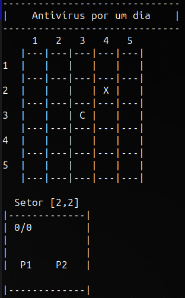

# Trabalho Paradigmas de Programação

## Tabuleiro

### Atributos
- `String titulo` -> O titulo do tabuleiro 
- `Setor setores[][]` → Uma matriz de setores

### Métodos
- `getSetor(int x, int y);` -> Retorna o setor (x, y)
- `getTipo(int x, int y);` → Retorna o tipo do setor (x, y)
- `getInimigos(int x, int y);` → Retorna o vetor de inimigos de setor (x, y)
- `setSetor(int x, int y);` -> Substitui o setor (x, y) por "setor"
- `setInimigos(int x, int y, Inimigo[] inimigos);` → Substitui o vetor de inimigos do setor (x, y)
- `setJogador(JogadorSimples p1);` → Define que p1 entrou no setor em que se encontra
- `setJogador(JogadorSuporte p2);` → Define que p2 entrou no setor em que se encontra
- `unsetJogador(JogadorSimples p1);` → Define que p1 saiu do setor em que se encontra
- `unsetJogador(JogadorSuporte p1);` → Define que p2 saiu do setor em que se encontra
- `movimentoLiberado(int x, int y, String porta);` -> retorna "true" caso a porta "porta" do setor (x, y) estiver aberta e false CC.
    OBS: porta = "UP"|"DOWN"|"LEFT"|"RIGHT".
- `imprimeTabuleiro();` → Imprime o tabuleiro

### Construtor

- Constrói a matriz quadrada de tamanho 5 → `Matriz[5][5]`
- Inicializa cada setor definindo um setor final de forma aleatória
- Indica o setor de inicio sendo o setor do meio → `Matriz [2][2]`

### Setor

- Possui atributos booleanos que indicam se o setor é final, inicial, está contendo o p1, p2; um vetor de inimigos de tamanho definido aleatóriamente e depois cada objeto inimigo é criado desse vetor; o tipo desse setor (normal, oculto ou privado).

## Imagens

### Tabela 1

### Tabela 2

